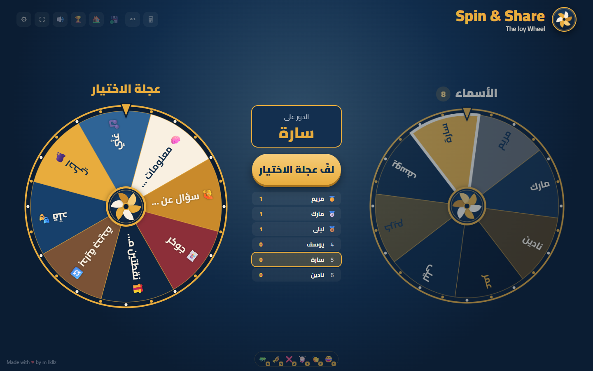
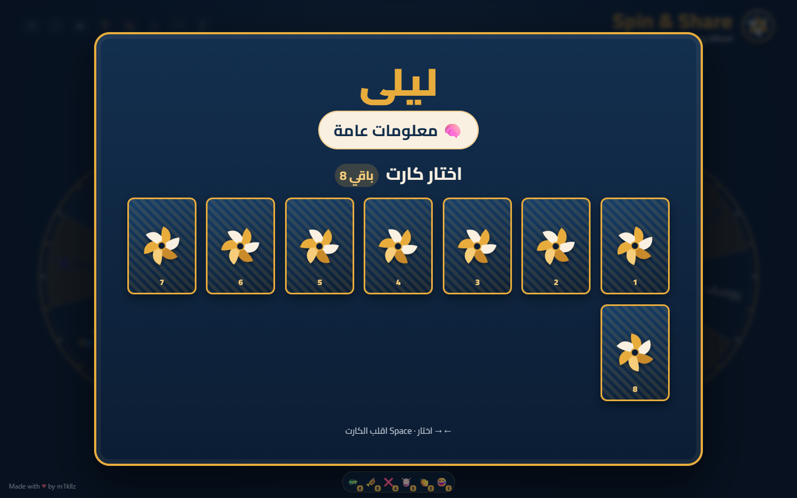
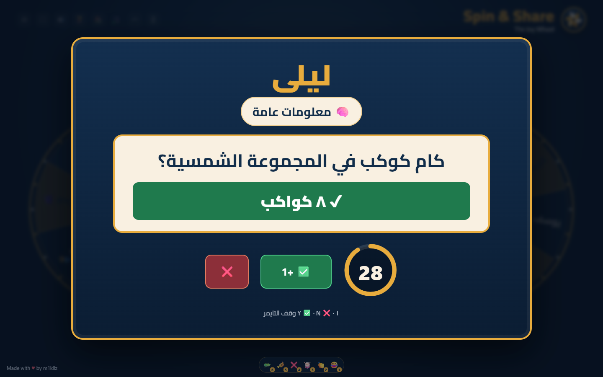
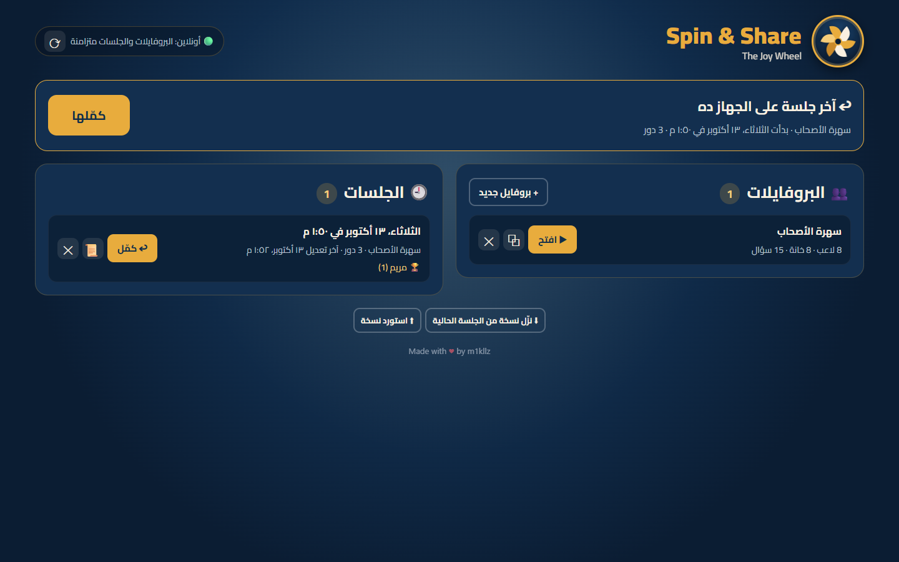
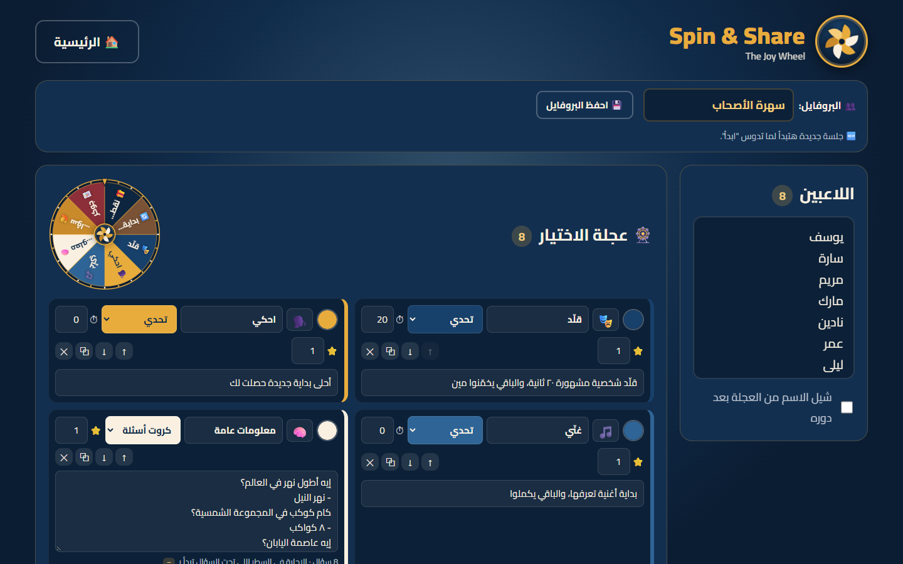
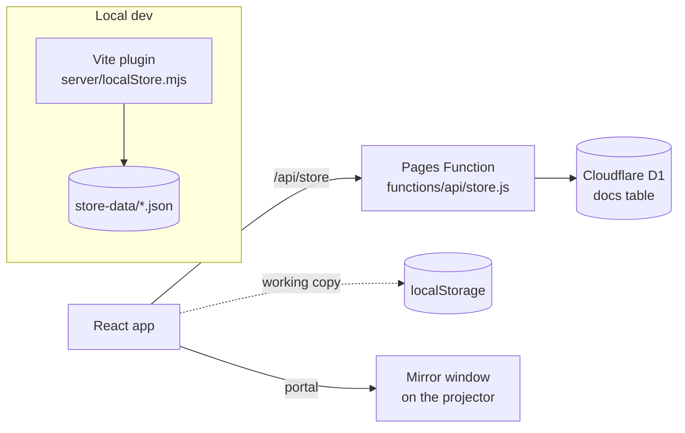

<div align="center">

# 🎡 Spin & Share — The Joy Wheel

**A spin-the-wheel party game for youth meetings.**
Spin a name, spin a challenge, pick a card. Scores, sessions and history are saved live, so any meeting can be continued from any device.

**[▶ Live demo: spinsharestjb.pages.dev](https://spinsharestjb.pages.dev)**



</div>

---

## Why

Built for a weekly youth meeting: one laptop, one projector, a room full of people. The host needed something faster than paper slips: pick who's next fairly, give them a challenge or a question, keep score, and pick up next week where they left off.

## Features

**Two wheels**

- **Names wheel.** Weighted random: nobody comes up twice in a row, and the longer someone waits the likelier they are. Players can be taken off the wheel after their turn.
- **Choice wheel.** Fully customizable: any number of slices, each with its own emoji, color, text, timer and points. Five slice types:

  | Type       | What happens                                                                                                                      |
  | ---------- | --------------------------------------------------------------------------------------------------------------------------------- |
  | Challenge  | Shows a task (e.g. "sing the start of a song"), optional countdown, host marks ✅ / ❌                                            |
  | Card bank  | Face-down cards; the player picks one, it flips to a question (with an optional answer to reveal). Drawn questions never repeat.  |
  | Joker      | "Pass it to a friend": the names wheel picks a helper (from _all_ players, except the owner), they play, the owner gets the point |
  | Gift       | Free points                                                                                                                       |
  | Spin again | Same player spins again                                                                                                           |

**Host tools**

- Live scoreboard, full score panel, undo for the last score change.
- **Profiles** (players + wheel + questions) and **sessions** (scores, who left the wheel, drawn cards, a turn-by-turn log), saved live to the server, listed on the home screen, continuable from any device.
- Editing names or questions mid-session keeps progress: newcomers join the wheel, drawn questions stay drawn.
- **Second-screen mode.** The game stays on the laptop while a mirror window opens full-screen on the projector (Window Management API). Both windows render the same spins, card flips, timers, confetti and emoji, with sound played once.
- Sound board with emoji rain: laugh, applause, drum roll, buzzer, sad trombone, crickets.
- Full keyboard / presentation-clicker control.
- Arabic, right-to-left UI.

## Screenshots

| Pick a card                          | Question with revealed answer              |
| ------------------------------------ | ------------------------------------------ |
|  |  |

| Profiles & sessions                | Wheel editor (live preview, emoji picker) |
| ---------------------------------- | ----------------------------------------- |
|  |       |

## Keyboard

| Key                            | Action                                                 |
| ------------------------------ | ------------------------------------------------------ |
| `Space` / `Enter` / `PageDown` | Spin · continue · select & flip a card · reveal answer |
| `←` `→`                        | Move between cards                                     |
| `Y` / `N`                      | Mark ✅ / ❌                                           |
| `R`                            | Reveal the answer                                      |
| `T`                            | Pause / resume the timer                               |
| `1`–`6`                        | Sound board                                            |
| `S`                            | Score panel                                            |
| `Z`                            | Undo last score change                                 |

## Tech

- **React 18 + Vite 7.** No UI framework; hand-written CSS with design tokens.
- **Canvas 2D** wheels. One rotation controller per wheel feeds every canvas that shows it, which is how the projector mirror stays frame-perfect.
- **React portal into a second window** for the mirror (same React tree, same state, no syncing protocol).
- **Web Audio** for ticks and chimes, and recorded clips for the sound board; `canvas-confetti`.
- **Cloudflare Pages + Pages Functions + D1** for hosting and storage.



The API logic lives once in `server/storeCore.mjs` and runs both in the Cloudflare Function (D1 backend) and in the Vite dev server (JSON files on disk), so local development needs no Cloudflare account.

### API

| Method   | Path                           |                             |
| -------- | ------------------------------ | --------------------------- |
| `GET`    | `/api/store?prefix=profiles/`  | List profiles (summaries)   |
| `GET`    | `/api/store?prefix=sessions/`  | List sessions (summaries)   |
| `GET`    | `/api/store?key=sessions/<id>` | One document                |
| `PUT`    | `/api/store?key=…`             | Save a document (JSON body) |
| `DELETE` | `/api/store?key=…`             | Delete a document           |

> **No authentication, on purpose.** The data is game content (names, questions, scores), and the requirement was "open the link on any laptop and play". Keys are validated and bodies are capped at 2 MB, but anyone with the URL can read and write. Don't store anything sensitive.

## Run locally

Requires Node 20+.

```bash
npm install
npm run dev
```

Open http://localhost:5173. Profiles and sessions are saved under `store-data/` (git-ignored). The default profile is seeded from [`public/game-data.json`](public/game-data.json).

## Deploy your own (Cloudflare, free tier)

```bash
npx wrangler login
npx wrangler d1 create spin-share                                  # put the printed database_id in wrangler.toml
npx wrangler d1 execute spin-share --remote --file db/schema.sql
npx wrangler pages project create <your-project> --production-branch main
```

Set `name` in `wrangler.toml` and `--project-name` in the `deploy` script of `package.json` to `<your-project>`, then:

```bash
npm run deploy
```

## Project structure

```
functions/api/store.js     Cloudflare Pages Function (D1 backend)
server/storeCore.mjs       Shared /api/store handler
server/localStore.mjs      Same API for the Vite dev server (files on disk)
db/schema.sql              D1 table
public/game-data.json      Default profile (players, slices, questions)
src/App.jsx                Game flow, sessions, second screen
src/components/            Wheel, cards, editor, home, scoreboard, …
src/lib/                   Wheel controller, random, sessions, sound, effects
```

## Credits

- Sound effects from [Mixkit](https://mixkit.co/free-sound-effects/), used under the [Mixkit Sound Effects Free License](https://mixkit.co/license/#sfxFree). They are **not** covered by this project's MIT license.
- [Cairo](https://fonts.google.com/specimen/Cairo) font via `@fontsource/cairo` (SIL Open Font License).
- [canvas-confetti](https://github.com/catdad/canvas-confetti) (ISC).

## License

[MIT](LICENSE) © 2026 m1kllz

---

<div align="center" dir="rtl">

**بالعربي:** لعبة عجلتين لاجتماعات الشباب. عجلة بتختار مين عليه الدور، وعجلة بتختار التحدي أو السؤال. فيها كروت أسئلة، ونقط، وجوكر، وشاشة عرض على البروجكتور، وكل جلسة بتتحفظ وتقدر تكمّلها من أي جهاز.

Made with ♥ by m1kllz

</div>
